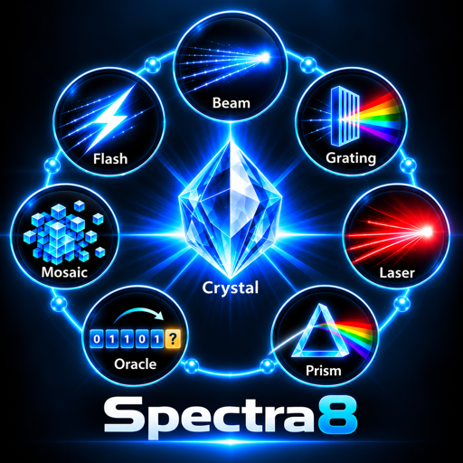
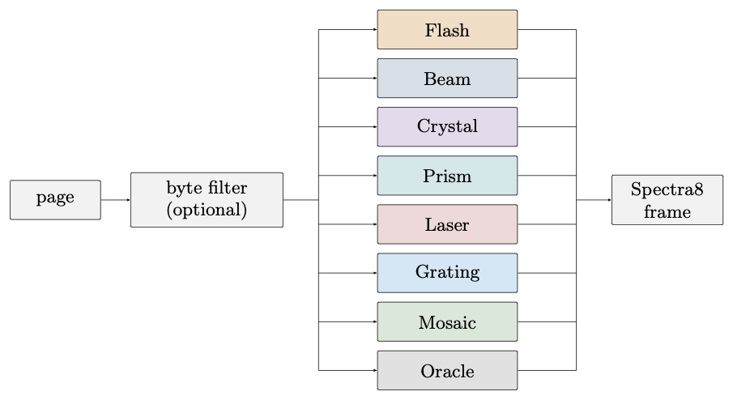
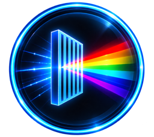
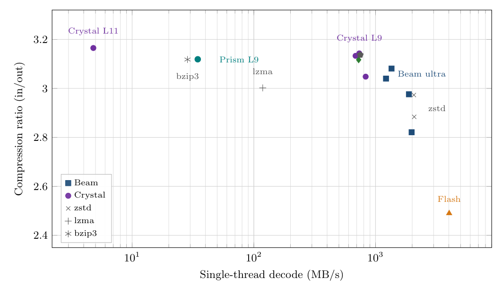
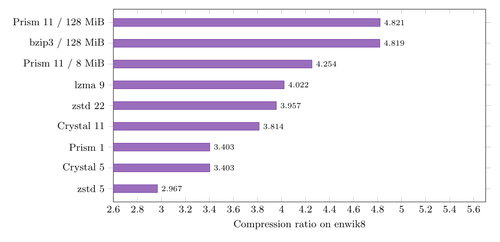
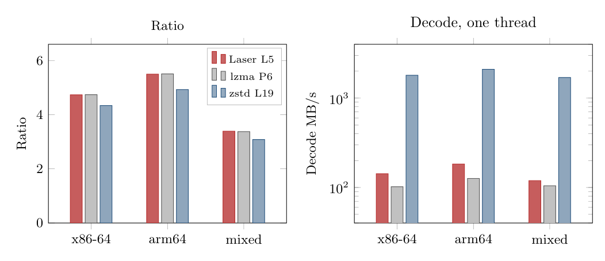
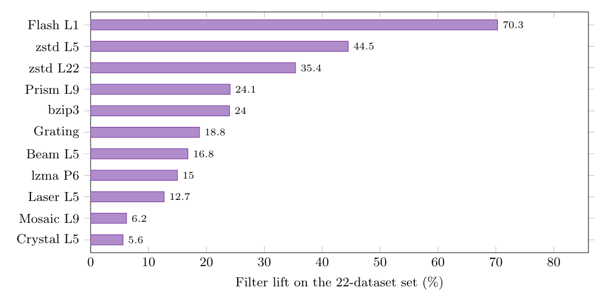
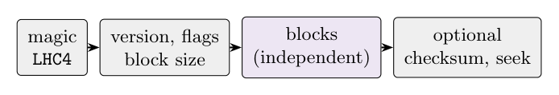

<p align="center">
  
</p>

# spectra8

**spectra8** is a compression framework developed as part of a research and development (R&D) initiative by Andreas J. Peters of the CERN IT Storage & Data Management Group, trying to reduce the size of scientific data beyond the current baseline provided by zstd and LZMA, while maintaining a suitable decoding speed per core. The most natural application of the compression framework is the [ROOT](https://root.cern/) RNTuple data format for high-luminosity LHC analysis, but it is usable in any other data processing context. The source code is available at <https://github.com/apeters1971/spectra8>.

> [!CAUTION]
> **Disclaimer:** This software is provided for research and experimental purposes, without warranties or guarantees of any kind. At this stage, no commitment is made regarding long-term maintenance, support, or continued development. Users assume full responsibility for its use and any associated risks.

On CMS and ATLAS Nano/Mini/xAOD files measured with this library, Crystal at level 5 produced output 5–14% smaller than the zstd or LZMA original, with page decompression at 0.6–1.6 GB/s. On text, Prism at level 11 ties bzip3 on the English Wikipedia dump and decodes faster. On shared libraries, Laser matches lzma and decodes faster, and it scales across blocks. The tables are in [Measurements](#measurements).

Each page contains a column of integers, floating-point values, or offsets. It ranges from a few hundred bytes to a few hundred KiB, and is written once but read many times. The framework provides eight compressors, data preprocessing filters, and a standardized frame format (`LHC4`). All codecs share the same frame format, a reversible filter stage, and a compression-level scale from 0 to 11. Encoding may involve an extensive search; decoding is designed around table lookups and copying.

A key feature is the automatic selection of filters and compression algorithms. For each block, the encoder evaluates preprocessing filters and candidate compressors, then selects the combination that produces the smallest output. It accepts a slower decoder only when the additional space savings exceed a configurable threshold.

The novel compressor is **Crystal**. It fits a static lattice to a column of integers or floats, and the decoder looks that model up in a table.

Version 2.0.0 includes a C++20 library, a C API, and a command-line tool. The command-line tool compresses and decompresses files and can benchmark entire directories of pages. The tool can also compress Wikipedia-scale text, shared libraries, executables, and integer columns with a sharply peaked distribution and a sparse tail. Append-only logs are covered in [Using spectra8 frames in log files](#using-spectra8-frames-in-log-files). Optional builds can produce native zstd, xz, and bzip3 frames, keeping those codecs available when the additional compression of a slower model is not worthwhile.

<p align="center">
  
</p>

## Overview

An RNTuple page is the basic unit of work. Storage and wide-area data transfers incur costs per byte, making compression ratio particularly important for structured numerical data. Decompression affects every analysis read, whereas compression is typically performed only once.

No single compression model works best for every page. Crystal is the core numerical codec, using a static lattice fitted to a sequence of integers or floating-point values. Flash and Beam are general-purpose byte-matching codecs suited to data ingestion and binary files. Prism uses block sorting for text. Laser models machine code, while Grating encodes peaked integer distributions as whole symbols. Mosaic and Oracle evaluate multiple models within each tile. Auto compares codecs under a decompression-speed constraint and retains zstd when the potential space savings are too small.

Within ROOT, RNTuple retains its existing file format. `kSpectra8` is algorithm 6, so compression setting `605` is Spectra8 at level 5, and the compression interface calls this library.

## Key features

| | Codec | `--codec` | Role | One-core decode |
|---|---|---|---|---|
|  | **Flash** | `flash` | Byte-aligned LZ77, tokens written directly. Ingestion. | 4–6 GB/s |
|  | **Beam** | `beam` | LZ77 with split literal, length and offset streams, Huffman or rANS. Default for binary input. Level 11 is the optimal parse. | 2–4 GB/s |
|  | **Crystal** | `crystal` | Static lattice for numeric columns, or BWT ranks into the same coder on text. Levels 10–11 switch to context mixing. | 0.6–1.7 GB/s |
|  | **Prism** | `prism` | LZP, Burrows–Wheeler, then MTF or a context mixer. Text, source, logs. | hundreds of MB/s on the fast path |
|  | **Laser** | `laser` | LZMA automaton with five decoupled range streams. Shared libraries and executables. | 120–185 MB/s |
|  | **Grating** | `grating` | Order-0 rANS on 1-, 2-, 4- or 8-byte integers, with a raw escape for the rare tail. No levels. | 1–3 GB/s |
|  | **Mosaic** | `mosaic` | Per-tile race of lattice ROLZ, a mini-BWT and Crystal. | ~650 MB/s |
|  | **Oracle** | `oracle` | Learned contexts and an affine residual. A demonstrator. Auto does not race it. | ~630 MB/s |

The decompression speeds shown are target ranges for a single CPU core. Measured results are available in [Measurements](#measurements).

The library also provides:

- **A common frame format.** Magic `LHC4`, independent blocks, an optional seek table and optional checksums. The decompressor recognizes Spectra8, L4EF, zstd, bzip3 and xz by magic.
- **A filter stage that never increases block size.** Shuffle, delta, XOR, frame-of-reference, dictionary remap, digit and word normalisation, Base64 undoing, and x86-64 / AArch64 branch normalisation. The encoder retains whichever is smaller: the filtered or unfiltered encoding.
- **Auto.** A decode-speed budget (`--auto-gain`). The preset `root` races only zstd, Beam and Crystal, the set intended for RNTuple pages.
- **Deterministic output.** Blocks never share matches, so the thread count does not change the bytes.
- **A C API and a C++ API** with the same codec selector, plus a page pump that decodes on the CPU and copies uncompressed pages to a GPU.

## Quick start

Requires CMake 3.20 or newer and a C++20 compiler.

```sh
cmake -S . -B build -DCMAKE_BUILD_TYPE=Release
cmake --build build -j
./build/spectra8 -z --codec beam -6 README.md /tmp/readme.lhc4
./build/spectra8 -d /tmp/readme.lhc4 /tmp/readme.out
cmp README.md /tmp/readme.out && echo roundtrip-ok
./build/spectra8 bench --explain
```

The compression and decompression commands report input size, output size, and compression ratio to stderr. `bench --explain` displays the codec table and exits. The round-trip example explicitly selects Beam to use the fast compression path. With no `--codec`, a text file selects Prism (see [Choosing a codec](#choosing-a-codec)).

## Prerequisites

| Requirement | Notes |
|---|---|
| CMake ≥ 3.20 | |
| C++20 compiler | GCC 13 or newer, or a current Apple Clang |
| POSIX threads | |
| libzstd, liblzma | Optional. Auto-detected. On macOS, `brew install zstd xz` |
| libbzip3 | Optional. A default build links a system shared library when one is present and stays Apache-2.0. Bundling the LGPL source is opt-in |

Tested platforms include Linux on x86-64 and AArch64, and macOS on Apple silicon (deployment target 13.0). Performance-critical loops are implemented in portable C++. On x86-64 the Crystal decode loop uses AVX2 and BMI2 when supported by the CPU. On Arm64, the corresponding loops are vectorized using NEON. An explicit sse2neon path is available with `-DSPECTRA8_USE_SSE2NEON=ON`.

## Installation

```sh
cmake -S . -B build -DCMAKE_BUILD_TYPE=Release
cmake --build build -j
cmake --install build --prefix /usr/local
```

The installation includes `bin/spectra8`, `libspectra8` (shared and static), the headers under `include/spectra8/` and a CMake package config.

```cmake
find_package(spectra8 REQUIRED)
target_link_libraries(myapp PRIVATE spectra8::spectra8)
```

Useful CMake configuration options:

| Option | Default | Effect |
|---|---|---|
| `SPECTRA8_BUILD_CLI` | `ON` | Build the `spectra8` tool |
| `SPECTRA8_BUILD_TESTS` | `ON` | Build the test suites |
| `SPECTRA8_ZSTD` | `AUTO` | `AUTO`, `ON` or `OFF` |
| `SPECTRA8_LZMA` | `AUTO` | `AUTO`, `ON` or `OFF` |
| `SPECTRA8_BZIP3` | `AUTO` | `AUTO`, `ON`, `OFF`, `SYSTEM`, or `BUNDLED` (LGPL, opt-in) |
| `SPECTRA8_METAL` | `ON` on Apple | GPU match finder. The MSL kernel is compiled at runtime |
| `SPECTRA8_HIP` | `OFF` | Same match finder for NVIDIA and AMD, via ROCm/HIP |
| `SPECTRA8_CUDA` | `AUTO` | Host-to-device transport for the page pump. No decoder kernels |
| `SPECTRA8_NATIVE` | `OFF` | `-march=native` |
| `SPECTRA8_LTO` | `OFF` | Link-time optimisation. Benchmark it; on some Apple Clang builds it slows compression |

## Usage

### Choosing a codec

With no `--codec`, the command-line tool samples the file:

| Input | Choice |
|---|---|
| Text (ASCII or UTF-8) | Prism, level 11, 128 MiB blocks, word filter on |
| Executable or shared library, when liblzma is linked | lzma, level 9, matching x86-64 or AArch64 branch filter |
| Anything else | Beam, level 6 |

`--codec`, `--level` or `--block-log` keeps the choice you passed. Laser is requested with `--laser`. For executables, Auto compares zstd, Laser, and LZMA.

```sh
spectra8 -z --codec crystal -5 page.bin page.lhc4
spectra8 -z --codec grating counts.i32 counts.lhc4
spectra8 -z --laser -5 libfoo.so libfoo.lhc4
spectra8 -z notes.txt notes.lhc4          # text: Prism, 128 MiB, word filter
spectra8 -z --codec auto -5 --auto-codecs=root --auto-gain=1 page.bin page.lhc4
spectra8 -d -T0 page.lhc4 page.bin        # magic-sniffed; -T0 uses every core
```

`-T0` / `--threads=0` sizes the thread pool according to the available hardware. The default is one thread. The output remains identical regardless of thread count.

### Using the compressors efficiently

Within a bound on encode and decode speed, the ratio is what matters. A large saving can pay for a slower codec. A saving of about 1% does not. Auto applies that per page and keeps zstd when the saving is too small. The preset `root` races zstd, Beam and Crystal, the set intended for RNTuple pages.

| Situation | Choice |
|---|---|
| Written and read at memory speed, or ingest that has to keep up with the disk | Flash. Auto does not race it. Level 0 selects this layout. |
| Ordinary binary, and the default when nothing else matches | Beam at level 6, in the 2–4 GB/s decode band. |
| Write time is available and the file should be smaller | `--ultra` (Beam level 11). The frame is still Beam and decodes at Beam speed. On text it is typically 10–15% smaller than level 9. |
| Numeric columns in production | Crystal at levels 5–9. Levels 10–11 are the context-mixing archival tier, at a few MB/s. |
| A peaked integer column read near memory speed | Grating. Use Crystal when that column has to be as small as the lattice can make it. |
| Text, source and logs kept for a long time | Prism at level 11 and 128 MiB blocks. `--codec prism -1` is the fast block-sorting path. |
| Shared libraries and executables | Laser, or lzma level 9 when liblzma is linked. |
| The Spectra8 saving does not clear the gain bar | zstd. It stays a first-class backend. |

Inside ROOT, give the transform to one side. Column encodings on and library filters off matches Crystal's stride-1 loop. Encodings off and library filters on lets Auto race filter and codec together. The two configurations are in [Columnar pages and ROOT](#columnar-pages-and-root).

### Basic examples

```sh
spectra8 -z -6 input.bin out.lhc4         # Beam, level 6
spectra8 -z --codec flash input.bin out.lhc4
spectra8 -z --ultra input.bin out.lhc4    # Beam level 11, optimal parse
spectra8 -z -c input.bin > out.lhc4       # stdout
spectra8 -d out.lhc4 restored.bin
spectra8 -z --codec zstd -3 in.bin out.zst    # native frame, if linked
spectra8 -z --codec lzma -6 in.bin out.xz
```

Standard zstd and xz tools can read the corresponding output frames. bzip3 frames are libbz3's container. The `bzip3` command-line tool does not read them. This library and libbz3 do.

### C++

```cpp
#include <spectra8/spectra8.hpp>
#include <stdexcept>

spectra8::CompressParams p;
p.codec = spectra8::Codec::Crystal;
p.level = 5;
p.filters = true;
p.threads = 1;

std::vector<std::byte> comp(spectra8::compress_bound(src.size(), p.codec));
auto r = spectra8::compress(src, comp, p);
if (!r)
  throw std::runtime_error(std::string(spectra8::status_message(r.status)));
comp.resize(r.value);

auto n = spectra8::get_frame_content_size(comp).value();
std::vector<std::byte> out(n);
spectra8::decompress(comp, out);
```

`Codec::Auto` with `auto_codecs = kAutoCodecsRoot` and `auto_min_gain_pct = 1` is the RNTuple-oriented call. `kAutoCodecsRoot` is zstd, Beam and Crystal. The full parameter list, seek tables, profiles and the page pump are in `include/spectra8/spectra8.hpp`.

The C ABI is `include/spectra8/spectra8_c.h`: `spectra8_compress_with_options`, `spectra8_decompress`, and the same codec enum (`SPECTRA8_CODEC_CRYSTAL`, `SPECTRA8_CODEC_GRATING`, …). Zero-initialise `spectra8_compress_options`. Set `auto_min_gain_pct` to 1 if you want the C++ default. A zero gain keeps the smallest output.

### Columnar pages and ROOT

RNTuple remains the container format, with each compressed page handled by a single library call. On disk the envelope is followed by a 9-byte `LC` header and a payload, which is a Spectra8 frame, an L4EF frame, or a native zstd, xz or bzip3 frame. Reading requires no process-wide configuration flags: the inner magic bytes identify the codec.

The suggested write-side startup, which is what `tree2ntuple` uses for its `spectra8_*` variants, lives in ROOT's `ZipSpectra8` wrapper:

```cpp
R__SetSpectra8Codec(kSpectra8CodecAuto);
R__SetSpectra8AutoMinGainPct(1);
R__SetSpectra8AutoCodecs(kSpectra8AutoCodecsRoot);  // zstd, Beam, Crystal
R__SetSpectra8Filters(1);
opts.SetEnableColumnEncoding(false);       // the library filters own the transform
opts.SetCompression(EAlgorithm::kSpectra8, 5);  // setting 605
```

Two configurations are recommended. ROOT column encodings on and library filters off is today's zstd path, and it is the layout Crystal's stride-1 loop is built for. Encodings off and library filters on lets Auto race filter and codec together. Enabling both typically increases compression time with little additional benefit.

The conversion and read-benchmark tools are included in the corresponding ROOT branch rather than this repository: `tree2ntuple`, `rntupleinspect`, `rntupletryzip` and `rntuple2rntuple`. `rntupletryzip` recompresses pages in memory and writes nothing, including for a CMSSW file whose streamer dictionaries are absent. `rntuple2rntuple --only-variant spectra8_crystal5` writes the file once the projection is worth keeping.

### Measurements

Compression ratios are calculated as input size divided by output size. Unless otherwise noted, throughput measurements use a single thread on Apple silicon. October 2026. On an EPYC 7316, compression ratios for scientific data are comparable, while Spectra8 decompression throughput is roughly half as high.

**Scientific columns.** Twenty-two datasets of 128 KiB (binary, plus int16/32/64 and float/double under binomial, Gaussian and Poisson margins), filters on, October 2026. The most desirable results appear in the upper-right corner. Flash and zstd dominate the high-throughput end. Crystal at levels 5 and 9, with Mosaic and Oracle on the same cluster, achieve the highest compression ratios at several hundred MB/s. Crystal level 11 achieves the highest compression ratio in this set, but uses a different, context-mixing decoder that runs at 4.8 MB/s.

<p align="center">
  
</p>

| Configuration | Ratio | Encode MB/s | Decode MB/s |
|---|---:|---:|---:|
| Flash | 2.490 | 1257 | 4025 |
| Beam L5 | 2.976 | 51 | 1880 |
| zstd L5 | 2.884 | 529 | 2078 |
| zstd L22 | 2.973 | 13 | 2066 |
| Crystal L5 | 3.133 | 19 | 685 |
| Crystal L9 | 3.143 | 3.5 | 735 |
| Mosaic L9 | 3.117 | 2.9 | 726 |
| lzma P6 | 3.002 | 16 | 118 |
| Prism L9 | 3.119 | 13 | 35 |

At level 5, Auto with a 5% gain threshold achieved a ratio of 3.128 and 943 MB/s decompression throughput in this run (zstd on 5 of 22 datasets, Beam on 5, Crystal on 12). Setting the gain threshold to 0 increased the ratio to 3.176 but reduced decompression throughput to 174 MB/s.

**Text.** The first 100 MB of the English Wikipedia XML dump (`enwik8`). Prism level 11 in one 128 MiB block slightly outperforms bzip3 at the same block size (ratio 4.821). With the word filter the same block reaches 4.828.

<p align="center">
  
</p>

**Binaries.** Forty-one unstripped x86-64 shared objects (24.8 MiB), 34 AArch64 Mach-O bundles (3.9 MiB), and 24 mixed build binaries (17.3 MiB), filters on. Laser level 5 matches lzma preset 6 on the two homogeneous sets and is slightly smaller on the mixed set, at 120–185 MB/s decode. Across blocks, Laser with a full thread pool reaches about 800 MB/s on the mixed set.

<p align="center">
  
</p>

**Peaked integers.** `spectra8 bench --verdict --rawint --no-filter`, six 128 KiB columns, Apple M5. Grating reaches ratio 4.08, encodes at 907 MB/s and decodes at 3.0 GB/s. Crystal level 5 reaches 4.55 at 647 MB/s decode. Choose Crystal when minimizing the size of an integer column is the priority, or Grating when near-memory-speed decoding matters most.

**CMS NanoAOD to RNTuple**, 1 MiB pages, format v2, library of 13 October 2026. Savings are measured relative to native zstd. Auto compares all eligible codecs at level 5 with a 1% gain threshold.

| Configuration | SinglePhoton gain | SingleElectron gain |
|---|---:|---:|
| native zstd | 0% (1.38 GiB) | 0% (406 MB) |
| Beam L5 | 4.2% | 3.6% |
| Crystal L5 | 13.8% | 12.0% |
| Auto L5 | 14.3% | 12.0% |

The `root` preset, racing only zstd, Beam and Crystal, comes within 0.6% of the full comparison while completing compression 4–7 times faster. When reading every SingleElectron entry, Crystal adds decompression overhead equivalent to 10–20% of a one-thread read and 2–6% with eight threads. With eight threads, the Crystal-compressed files finish slightly faster than their zstd counterparts because they are 12% smaller and decompression overlaps with deserialization.

**Full rewrites to Crystal level 5:**

| File | Original | Input | Output | Saving | Page unzip |
|---|---|---:|---:|---:|---|
| gg | zstd 5 | 543 MiB | 513 MiB | 5.6% | 1.6 GB/s (zstd original 8.9 GB/s) |
| miniAOD | LZMA 4 | 5.88 GiB | 5.39 GiB | 8.4% | 652 MB/s (LZMA original 251 MB/s) |
| ATLAS xAOD | LZMA 1 | 9.71 GiB | 9.04 GiB | 6.9% | 654 MB/s (LZMA original 106 MB/s) |

A filter is retained for 54% of xAOD pages, compared with just 0.1% of gg pages. Learned Crystal profiles are optional: at the 1 MiB page default a dynamic model is slightly smaller, and the learned model becomes worthwhile for smaller pages or when compression CPU time is constrained.

Reproduce a synthetic table locally with `spectra8 bench --verdict`, a real page dump with `spectra8 bench --dir /path/to/pages`, text with `spectra8 bench --text`, binaries with `spectra8 bench --verdict --binaries`, and peaked integers with `spectra8 bench --verdict --rawint --no-filter`.

### Filters

**Filters.** `--filter` scores a 16 KiB sample from the middle of the block and keeps a transform only when the filtered block is smaller. The plot shows results from the same 22 datasets on an Apple M5. Filter improvement is calculated as the filtered compression ratio divided by the unfiltered ratio, minus one. Byte-matching codecs benefit substantially. Crystal, which already models the data structure, improves by approximately 6%.

<p align="center">
  
</p>

`--filter-mask=32` (or `16` or `64`) restricts detection to a single element width when the caller knows the column type.

| Filter | What it does |
|---|---|
| `shuffle16`, `shuffle32`, `shuffle64` | Byte transpose of 2-, 4- or 8-byte elements |
| `delta16`, `delta32`, `delta64` | Subtract the previous element |
| `zigzag_delta16`, `zigzag_delta32`, `zigzag_delta64` | Signed element delta, stored as a small unsigned value |
| `delta32+shuffle32`, `delta64+shuffle64` | Delta, then byte transpose |
| `zigzag_delta32+shuffle32` | Zig-zag delta, then byte transpose |
| `zigzag32+shuffle32`, `zigzag64+shuffle64` | Zig-zag of the raw value, then byte transpose |
| `bitshuffle32`, `bitshuffle64` | Bit-plane transpose |
| `delta32+bitshuffle32` | Delta, then bit-plane transpose |
| `dict16`, `dict32`, `dict64` | Replace values with dense ids into the block's distinct set |
| `for16`, `for32`, `for64` | Frame-of-reference: subtract the minimum and bit-pack the residuals |
| `alp32`, `alp64` | Map floats onto decimals, then frame-of-reference packing |
| `xorshuf32`, `xorshuf64` | XOR with the previous element, then byte transpose |
| `d2shuf32`, `zzd2shuf32`, `d2shuf64` | Second-order delta, then byte transpose |
| `lag2shuf32`, `lag2shuf64` | Subtract the element two back, then byte transpose |
| `xorlag2shuf32` | XOR with the element two back, then byte transpose |
| `bcj_x86`, `bcj_arm64` | Normalise x86-64 or AArch64 branch targets |
| `digit_norm` | Collapse ASCII digits in text, logs and markup |
| `word_norm` | Replace repeated words and tags with one-byte tokens |
| `base64` | Turn embedded Base64 back into bytes |
| `bitround32`, `bitround64` | Drop trailing mantissa bits. This one is lossy |

## Using spectra8 frames in log files

Each input line is stored as a separate Spectra8 frame encoded on a single Base64 line, so the file stays append-only and can be monitored with `tail`.

```sh
spectra8 --logfile app.log                 # writes app.log.l4l
spectra8 tail -n 20 -f app.log.l4l
cat app.log | spectra8 --logfile -c > app.l4l
```

## GPUs

### Encoding

Part of Beam's encoder runs on the GPU. `--gpu --ultra` asks the device for the top few match candidates at each position. The CPU still runs the optimal parse, the entropy coder, and the frame. The improvement is moderate. On literal-heavy text and JSON the GPU finder can keep up with an all-core CPU search. On data with long matches the CPU chain finder often still produces the smaller file. `--gpu` on its own feeds a single best match into a greedy parse, which is the throughput path. In both cases the output is an ordinary Spectra8 frame, and the decoder is unchanged.

Flash, Crystal, Prism, Mosaic, Oracle, and the rest of Beam stay on the CPU. Metal is the default on Apple. HIP (`-DSPECTRA8_HIP=ON`) is the same match finder for NVIDIA and AMD, and it has not been run on that hardware in this tree. The default `compress()` path stays on the CPU. The greedy GPU hash is not bit-deterministic, which is why `--gpu` is opt-in. The top-K search used by ultra is deterministic. `spectra8 bench --gpu` compares the CPU and GPU finders.

### Page pump

`PagePump` (`include/spectra8/page_service.hpp`) is how a GPU reads pages from a compressed frame. It is independent of the encoder above and works for every codec this library can decompress. A Spectra8 frame is one page per block. A zstd, bzip3, xz, or L4EF frame is a single page. Decode stays on the CPU. Beam and Flash already run at 2–6 GB/s, enough for a few cores to fill a PCIe Gen4 link. The pump copies the plain pages into device memory.

`push_all` and `push_range` unzip the next batch while the previous batch is copied. The copy uses a pinned ring of three slots and gathers pages into batches of up to 8 MiB. `GpuBackend::Default` uses the first real GPU, and otherwise a host buffer. CUDA (`-DSPECTRA8_CUDA=AUTO`), HIP, and Metal can carry that copy. The C API is `spectra8_page_pump_*`.

```cpp
#include <spectra8/page_service.hpp>

spectra8::PagePump pump;
pump.bind(comp);
void* dev = pump.transport().alloc_device(pump.total_bytes());
pump.push_all(dev);
pump.transport().free_device(dev);
```

`spectra8 bench --h2d --codec beam` times the unzip, the copy, and the overlapped pump. See [`docs/cpu-h2d-page-service.md`](docs/cpu-h2d-page-service.md).

## Configuration

Some useful command-line options are listed below. `spectra8 --help` is the full list.

| Flag | Meaning |
|---|---|
| `-0` … `-9`, `--level=N` | Level 0–11. Level 0 selects the Flash layout. Default 6 |
| `--ultra` | Level 11 |
| `--block-log=N` | Block size, log2 bytes, 14–28 (16 KiB … 256 MiB) |
| `--filter`, `--filter-mask=LIST` | Byte-filter stage, optionally restricted |
| `--auto-gain=N` | Percent a slower decoder must save per doubling of decode time. Default 1. `0` keeps the smallest |
| `--auto-codecs=root` | Race zstd, Beam and Crystal |
| `--auto-max-level` | Race each codec at its own highest effort |
| `--seek-table`, `--block-crc`, `--content-crc` | Random access and checksums. Off by default. Spectra8 frames only |
| `--gpu` | Beam match finding on the GPU, when the build has one |

Auto evaluates candidates in order of their nominal decompression speed, from fastest to slowest. The nominal rates, in MB/s, are zstd 2000, Beam 700, Crystal 300 (8 at levels 10–11), Mosaic 280, Laser 180, Prism 140, lzma 70, bzip3 16. A codec that decodes twice as slowly has to be `gain` percent smaller.

Environment variables used for benchmarking and selected configuration settings:

| Variable | Effect |
|---|---|
| `SPECTRA8_ENWIK8`, `ENWIK8_PATH` | Path to the enwik8 corpus for `bench --text` |
| `SPECTRA8_BINARIES_DIR` | Directory of shared libraries for `bench --binaries` |
| `SPECTRA8_BWT_ENCODE_CHAINS` | `4`, `8`, `12` or `16`. `bench --bwt-chains` prints a suggestion |
| `SPECTRA8_CRYSTAL_TABLES` | `dense` (default) or `compact` slot-to-symbol tables |
| `SPECTRA8_CRYSTAL_LSTM` | Experimental Crystal context-mixing input. Not a portable shipping format |
| `SPECTRA8_CONTEXT_ORACLE` | Turns on the context-cost model used by `--context-oracle` |

## Architecture

<p align="center">
  
</p>

A block-type byte identifies the codec: stored, memset, Beam, Prism, Mosaic, Oracle, Crystal, Flash, Laser or Grating. The high bit marks the last block. Matches and contexts never cross a block boundary, so compression and decompression scale across blocks and the ratio does not depend on `-T`.

External codecs retain their native frame formats. When `--filter` wraps one of them, the wrapper is an `L4EF` frame and the inner payload stays zstd, xz or bzip3. `decompress()` sniffs the magic and dispatches. `codec_available()` reports what the build linked.

Levels 0–11 provide a common control, although their meaning varies by codec. Through level 9 the Crystal, Flash and Beam decoders do not change with the level. The level controls the encoder's search effort and, in many cases, the default block size. Learned profiles are selected by a profile id, not by this scale.

| Piece | Where |
|---|---|
| Library | `libspectra8`, `include/spectra8/spectra8.hpp` |
| C ABI | `include/spectra8/spectra8_c.h` |
| CLI, benchmark, logfile tail | `cli/` |
| Codecs and frame | `src/` |
| Suffix array for the BWT paths | vendored `third_party/libsais` (Apache-2.0) |

## Testing

```sh
cmake -S . -B build -DCMAKE_BUILD_TYPE=Release
cmake --build build -j
ctest --test-dir build --output-on-failure
```

`spectra8_tests` round-trips and fuzzes. `spectra8_api_tests` covers the API, error reporting, the C ABI and entropy modes. Further suites cover the streaming decoder and the logfile format.

Frames encoded on one supported platform must be decodable on the others. `tests/compat/compat.sh` encodes a deterministic corpus (numeric pages, a log, source) across codecs and levels, and decodes a corpus produced elsewhere.

```sh
SPECTRA8=build/spectra8 tests/compat/compat.sh encode /tmp/spectra8-compat
SPECTRA8=build/spectra8 tests/compat/compat.sh decode /tmp/spectra8-compat
```

## Contributing

Issues and pull requests are welcome. Use the commands in [Testing](#testing) and run `ctest` before submitting changes. A wire-format change (a new block type, a new filter id, a header field) also requires an entry in `tests/compat/compat.sh`, so a corpus encoded after the change includes it. Frames encoded before the change must still decode.

The code in `src/`, `include/`, `cli/` and `tests/` is an independent C++20 implementation. Please use the same Apache-2.0 license header as the surrounding files for any new source code. `NOTICE` records the vendored and optional third-party pieces.

## License

Copyright (C) 2026 CERN. Author: Andreas Joachim Peters.

[Apache License 2.0](LICENSE) (`SPDX-License-Identifier: Apache-2.0`). `NOTICE` lists attribution and the licenses of vendored and optional components: libsais (Apache-2.0), bzip3 (LGPL-3.0-or-later, and only when you pass `-DSPECTRA8_BZIP3=BUNDLED` or `SPECTRA8_BZIP3_SOURCE`), and zstd, xz and sse2neon when you link or fetch them. A default build produces Apache-2.0 binaries.

## AI development

Generative AI tools were used throughout the research and development as interactive collaborators in the exploration, implementation, refinement and optimisation of the compression method. That work was done in Cursor.

Four model families were used, with distinct roles:

- **xAI Grok 4.6 and 4.7:** interactive code development, algorithmic refinement, debugging and performance optimisation.
- **Anthropic Claude Fabel 5.1:** code generation, implementation refinement and optimisation.
- **Google Gemini 3.8 and 4.0:** code development, algorithmic experimentation and performance optimisation.
- **OpenAI ChatGPT:** topical discussion, conceptual exploration, technical reasoning and examination of related ideas.

The codebase and the algorithms evolved through those interactions. Suggestions, alternative implementations and optimisation strategies were taken into an ongoing process of experimentation, evaluation and refinement.

The method builds on concepts from earlier research and adds a new integration of those ideas. The author directed the research, selected and evaluated the algorithmic approaches, and is responsible for the architecture, the implementation, the experimental findings and the originality claims.

The use of generative AI is disclosed for scientific transparency. The systems are development and research tools. They are not authors of this work.

## Support

Andreas-Joachim Peters, CERN, [andreas.joachim.peters@cern.ch](mailto:andreas.joachim.peters@cern.ch).

Please report security vulnerabilities privately by emailing the maintainer rather than opening a public issue.

| Question | Where |
|---|---|
| How do I call the library? | `include/spectra8/spectra8.hpp`, `include/spectra8/spectra8_c.h` |
| Do frames decode on another machine? | `tests/compat/compat.sh` |

### Limitations

- Oracle and Grating are not in the Auto race. Ask for them with `--codec`.
- The HIP match finder mirrors the Metal one and has not been run on NVIDIA or AMD hardware in this tree. Check it on your GPU before relying on it.
- `SPECTRA8_CRYSTAL_LSTM` is an experiment. Streams depend on identical floating-point behaviour and are not a shipping format.
- bzip3 output is libbz3's `bz3_compress` container, which differs from the `bzip3` CLI file format.
- Decode stays on the CPU. A GPU receives pages after they have been decompressed.
- Mantissa rounding (`bitround32` / `bitround64`) drops trailing bits. It is a separate choice from the lossless filters.

### FAQ

**A text file compresses slowly.** With no `--codec`, text selects Prism at level 11 and 128 MiB blocks. This is the archival text compression mode. `--codec beam` or `--codec flash` is the fast general path. `--codec prism -1` is the fast block-sorting path.

**`decompression failed` or "no recoverable content size".** The input is not an LHC4, L4EF, zstd, bzip3 or xz frame, or the frame omitted its content size. If necessary, supply the original size through the library API and provide a destination buffer of the appropriate size.

**An optional benchmark row prints `n/a`.** The corresponding backend was not linked into the build. Install the development package and reconfigure, or set `-DSPECTRA8_ZSTD=ON` (and the lzma / bzip3 equivalents) to make a missing dependency a configure error.

**The output file already exists.** Pass `-f`.

**ROOT encodings and `--filter` both ran.** Pick one of the two configurations in [Columnar pages and ROOT](#columnar-pages-and-root). Using both generally provides little benefit.
