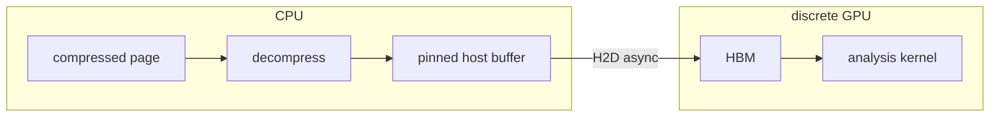
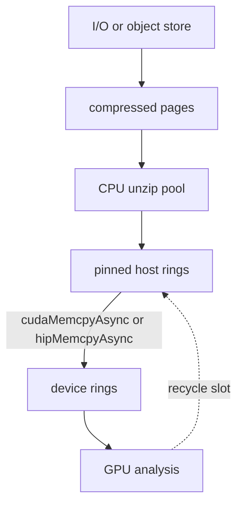

# CPU decompress + H2D for GPU consumers

**Decision (2026-09-15): keep Spectra8 encode and decode on the CPU. Feed discrete
NVIDIA/AMD GPUs with an async host-to-device (H2D) copy of already-decompressed
pages. Do not port Beam, Crystal, Prism, Mosaic, or Oracle decode (or
Crystal/Prism/Mosaic encode) to HIP/CUDA.**

This note records why, and the host-side pipeline to use instead.

Target machines: discrete PCIe nodes (x86 + A100/H100/MI250 and similar).
Coherent superchips (Grace-Hopper, MI300A) make a GPU decoder even less
attractive; they are out of scope here.

## What already runs on a GPU

The only GPU work in this repo is **encode-side LZ match finding**, not decode.
See the README “GPU acceleration” section and [`src/gpu/gpu_match.hpp`](../src/gpu/gpu_match.hpp).
Metal (Apple) and HIP (NVIDIA/AMD) find a bounded best match — or top-K
candidates for the ultra parser — per 64 KiB chunk. The sequential parse,
recent-offset model, entropy, Crystal, BWT, filters, and **all decode** stay on
the CPU. Output is an ordinary Spectra8 frame.

The HIP backend in [`src/gpu/hip_lz.cpp`](../src/gpu/hip_lz.cpp) mirrors Metal
but has not been run on NVIDIA/AMD hardware in this project. If faster *Beam
compress* on those cards matters later, the work is to validate and tune that
finder — not to rewrite Crystal or Prism.

That optional encode offload is independent of this decision. Page *consumption*
on a GPU always goes through the CPU decoder and H2D.

## Why the decoders stay on the CPU

A full GPU port of “the Spectra8 algorithms” would be a second implementation of
five mixed codecs whose hot loops are sequential by design.

| Codec | CPU decode (README) | Intra-page parallelism | Why not a GPU kernel |
| --- | --- | --- | --- |
| Beam | 2–4 GB/s | After entropy, LZ replay is a serial write that reads earlier output ([`decode_compressed_block`](../src/decoder.cpp)) | Same family as LZ4-on-GPU (nvCOMP): possible, large, and the CPU is already at PCIe-class bandwidth |
| Crystal static | 500–650 MB/s | 8–16 interleaved rANS streams; each byte needs prior lattice neighbours + ANS state ([`decode_one`](../src/crystal/crystal_static.cpp)) | At most 16 live lanes per page. A workgroup sits mostly idle unless hundreds of pages are batched |
| Crystal BWT / Prism | 150–250 / 350–650 MB/s | Inverse BWT is an LF pointer chase ([`bwt_decode.hpp`](../src/prism/bwt_decode.hpp)); the CPU already uses 16 chains for memory-level parallelism | Scattered loads, latency-bound |
| Mosaic / Oracle / Auto | ~630–650 MB/s | Per-tile race: ROLZ, mini-BWT, Crystal, Beam | Divergent kernels; Auto frames can mix types in one file |
| Crystal L10–11 CM | 5–20 MB/s | Adaptive, symmetric | Do not port |

Filters (shuffle / delta / dict / bitshuffle) *are* GPU-friendly, but they run
**after** the codec. The Spectra8 payload still has to be decoded first.

`Codec::Auto` is a second reason to stay on the CPU: a GPU decoder would have to
implement every winner, or reject mixed frames. The CPU path already sniffs
magic and dispatches (`decompress` / `decompress_block` in
[`include/spectra8/spectra8.hpp`](../include/spectra8/spectra8.hpp)).

## Bandwidth on discrete PCIe

Typical RNTuple-style page: 64 KiB–1 MiB raw, ratio ~3 → ~20–300 KiB on the wire.

A GPU decoder’s only prize is not sending uncompressed bytes over PCIe. That
prize is real on discrete cards, but only if the analysis kernel is starved on
H2D, many independent pages stay in flight, *and* GPU decode of that codec is
not much slower than CPU decode plus copy.

PCIe Gen4 x16 is about 25–28 GB/s practical. Beam on a few CPU cores already
exceeds that. Crystal at roughly 0.5–0.7 GB/s per thread needs a small unzip
pool (`DecompressParams::threads`) to fill a Gen4 link. For Beam pages, CPU
decode plus pinned async copy is already at the PCIe ceiling. For Crystal or
Prism, a 4–8 thread unzip pool usually is too.

A naive GPU Crystal kernel (16 serial streams per page, one page per launch)
would lose to that pool on both latency and engineering cost.

## Architecture: in-process CPU page service + H2D

Not a separate daemon unless several languages or processes must share one GPU.
ROOT/RNTuple already has the same pattern (I/O → unzip pool → consumer). Use
the library in-process.

Concrete pieces, all using APIs the library already has:

- **Random access.** Write frames with `--seek-table` and call
  `decompress_block(index)` so a consumer can request page *i* without decoding
  the whole cluster.
- **Unzip pool.** `DecompressParams::threads` or a small dedicated pool.
  Block-parallel decode is already deterministic and independent.
- **Staging.** Two or three slots of CUDA/HIP **pinned** host memory per
  in-flight column (or a shared arena). Overlap: unzip page N+2, H2D page N+1,
  kernel on page N.
- **Batch the DMA.** Coalesce many small pages into one copy when the kernel
  wants a whole cluster. Many 64 KiB copies kill PCIe; one 8–32 MiB copy does
  not.
- **Codec-agnostic.** Mixed Auto frames stay on the CPU dispatcher.

This is not a new Spectra8 format and not a rewrite of
[`src/decoder.cpp`](../src/decoder.cpp). It is a thin host-side pipeline around
`decompress` / `decompress_block`.

Optional later, still with CPU decode: GPUDirect Storage for the *compressed*
bytes, or a coherent superchip where the unzip pool writes memory the GPU can
read with no explicit H2D.

## Implementation

The library ships this path (no GPU decoder):

- C++: [`include/spectra8/page_service.hpp`](../include/spectra8/page_service.hpp)
  — `GpuTransport`, `PagePump`, `decompress_to_device`, `get_page_sizes`.
- C: `spectra8_page_pump_*` in [`include/spectra8/spectra8_c.h`](../include/spectra8/spectra8_c.h).
- Backends: `Host` (always; memcpy into a heap buffer), `Cuda` (`-DSPECTRA8_CUDA=AUTO`),
  `Hip` (with `-DSPECTRA8_HIP=ON`), `Metal` (Apple, default on).
  `GpuBackend::Default` picks the first real GPU, else Host.
- CLI: `spectra8 bench --h2d [seconds] [size] [--codec NAME]` times CPU unzip,
  H2D of already-decoded pages, the overlapped pump, and a dummy D2H consume.

`PagePump::bind` treats Spectra8 blocks as pages (seek table or header scan). Other
frames are one page. `push_range` unzips a batch into a pinned ring slot and
issues `h2d_async`, overlapping unzip of the next batch with the previous copy.

## Out of scope

These were considered and rejected for the GPU analysis path:

- Porting Prism/Crystal inverse BWT, Beam sequence replay, Mosaic/Oracle
  dispatch, or Crystal context mixing to HIP/CUDA.
- A research Crystal-static kernel (one workgroup per page, 8–16 rANS lanes).
- Moving filter inversion to the GPU as a first step. Filters still sit behind
  a CPU codec decode; they are not needed to ship H2D.

Encode-side HIP match finding remains an optional Beam compress acceleration.
It does not change how pages are served to a GPU.

## Check that H2D is enough

On one discrete GPU node, time three legs for a real RNTuple-sized page batch
(64 KiB–1 MiB, Crystal and Beam):

1. CPU `decompress_block` only
2. H2D of uncompressed pages (pinned, async, 2–3 deep)
3. A dummy kernel that reads the device buffers

If (1)+(2) hide under (3), the pipeline is already right. Revisit a decoder
port only if a later profile shows uncompressed H2D as the stall *and* the
unzip pool cannot fill the link — and even then, as a narrow experiment, not
a port of the suite.
